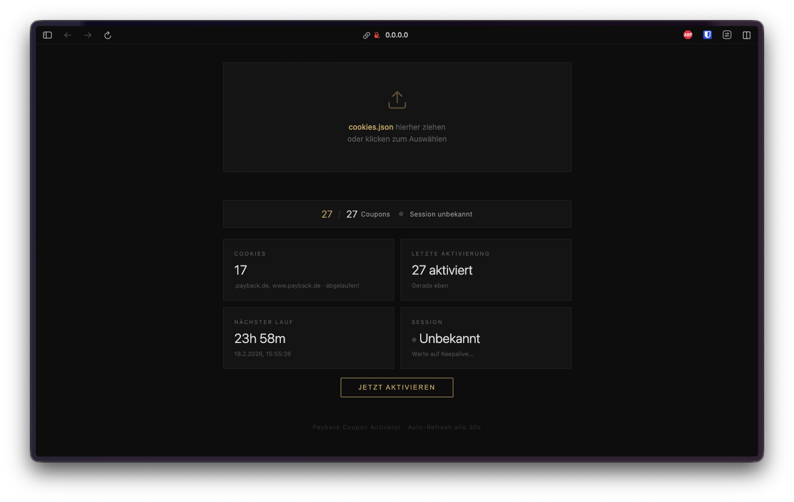
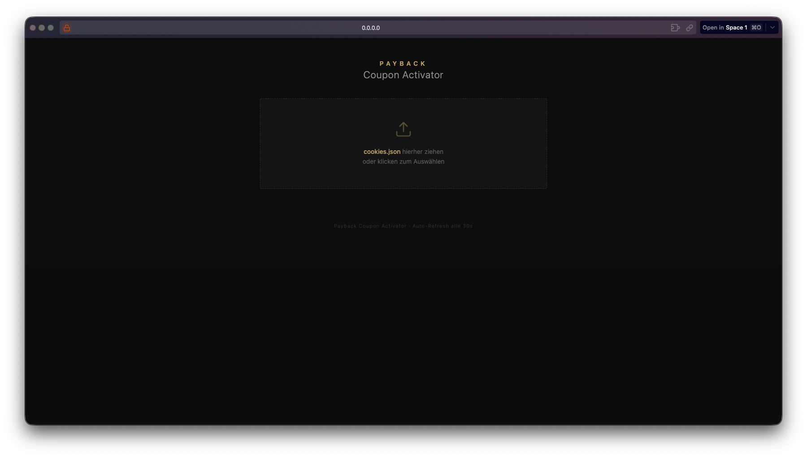

# Payback Coupon Activator
> Automatisierte Aktivierung aller verfügbaren Payback-Coupons per Playwright-Browser-Automation, gesteuert über ein Web-Dashboard.



> **Disclaimer:** Dieses Tool dient ausschliesslich der persönlichen Nutzung. Verwendung auf eigene Verantwortung. Nutzungsbedingungen von Payback beachten.

## Übersicht

Das Projekt ist ein Long-running Python-Service, der in regelmäßigen Intervallen (Standard: 24 h) auf [payback.de/coupons](https://www.payback.de/coupons) navigiert und alle nicht aktivierten Coupons per Klick aktiviert. Authentifizierung erfolgt über eine vom Benutzer exportierte `cookies.json`, die beim Start oder zur Laufzeit per Drag-and-Drop in das mitgelieferte FastAPI-Dashboard hochgeladen wird.

Zusätzlich läuft stündlich ein Keepalive-Job, der die Session warm hält, damit die Cookies nicht vorzeitig ablaufen.

Eigenschaften:

- Headless-Browser via Playwright Chromium (Docker-Image `mcr.microsoft.com/playwright/python`)
- Scheduler über APScheduler (Activation + Keepalive)
- Web-Dashboard mit Live-Status, Cookie-Upload, manueller Trigger
- Rate-Limit-Schutz: nach `RATE_LIMIT_BATCH_SIZE` Coupons Pause für `RATE_LIMIT_PAUSE_HOURS`
- Strukturierte Logs via loguru, tägliche Rotation, 7 Tage Retention
- Atomarer Cookie-Upload (tempfile + `os.replace`), 1 MB Limit, Schema-Validierung
- Cookie-Metadaten-Extraktion ohne Token-Werte zu lesen (`extract_cookie_metadata`)

## Tech-Stack

| Kategorie | Technologie |
|---|---|
| Sprache | Python 3 (Playwright-Base-Image jammy) |
| Browser-Automation | Playwright 1.58.0 (Chromium, async API) |
| Web-Framework | FastAPI + Uvicorn (standard) |
| Scheduler | APScheduler (AsyncIOScheduler, IntervalTrigger) |
| Logging | loguru |
| Config | python-dotenv |
| Upload | python-multipart |
| Container | Docker, docker-compose |
| Base-Image | `mcr.microsoft.com/playwright/python:v1.58.0-jammy` |
| Lizenz | MIT |

## Architektur

```
+--------------------+        +-------------------------+
|  APScheduler       |        |  FastAPI Web-Dashboard  |
|  - activation/24h  |        |  - GET  /               |
|  - keepalive/1h    |        |  - GET  /api/status     |
+---------+----------+        |  - POST /api/cookies    |
          |                   |  - POST /api/trigger    |
          v                   +------------+------------+
+---------+----------+                     |
|  run_activation /  |<--------------------+ (manual trigger)
|  run_keepalive     |
+---------+----------+
          |
          v
+---------+----------+        +------------------------+
| create_browser /   +------->+ Playwright Chromium    |
| create_browser_ctx |        | (headless, de-DE)      |
+---------+----------+        +-----------+------------+
          |                               |
          v                               v
+---------+----------+        +-----------+------------+
| coupon_activator.  +------->+ payback.de/coupons     |
| activate_all_      |        | Klick auf Buttons mit  |
| coupons            |        | .not-activated         |
+--------------------+        +------------------------+
```

`AppState` (Singleton in `src/web/state.py`) hält den geteilten Status zwischen Scheduler-Jobs und Dashboard.

## Ordnerstruktur

```
payback-activator/
├── src/
│   ├── __init__.py
│   ├── main.py                 # Einstiegspunkt, Scheduler, Signal-Handler
│   ├── config.py               # ENV-basierte Konfiguration
│   ├── browser.py              # Playwright-Setup + Cookie-Loader
│   ├── coupon_activator.py     # Klick-Logik + Keepalive
│   └── web/
│       ├── __init__.py
│       ├── app.py              # FastAPI-Routen + Lifespan
│       ├── state.py            # AppState + Cookie-Metadaten
│       └── static/
│           └── index.html      # Dashboard (Vanilla JS, dunkles Theme)
├── data/                       # Volume: cookies.json (persistent)
├── logs/                       # Volume: tägliche Logs
├── docs/                       # Screenshots fürs README
├── Dockerfile
├── docker-compose.yml
├── requirements.txt
├── .env.example
├── .dockerignore
├── .gitignore
├── LICENSE
└── README.md
```

## Setup & Installation

### Voraussetzungen

- Docker + Docker Compose (empfohlen) **oder** Python 3 mit Playwright lokal
- Eine gültige `cookies.json` von payback.de (Export via Browser-Extension)

### Cookie-Export

1. Bei [payback.de](https://www.payback.de) einloggen
2. Browser-Extension **Cookie-Editor** installieren ([Chrome](https://chromewebstore.google.com/detail/cookie-editor/hlkenndednhfkekhgcdicdfddnkalmdm) · [Firefox](https://addons.mozilla.org/de/firefox/addon/cookie-editor/))
3. Auf payback.de Extension öffnen → **Export → JSON**
4. Datei über Web-Dashboard hochladen **oder** als `data/cookies.json` ablegen

Cookies müssen erneuert werden, wenn die Session abläuft (Status im Dashboard sichtbar).

### Docker (empfohlen)

```bash
git clone ssh://git@ssh.github.com:443/fynnsh/payback-coupon-activator.git
cd payback-coupon-activator
cp .env.example .env
docker compose up -d
```

Dashboard öffnen unter `http://localhost:8080`, `cookies.json` per Drag & Drop hochladen.



## Entwicklung

### Lokal ohne Docker

```bash
python -m venv venv
source venv/bin/activate
pip install -r requirements.txt
playwright install chromium
python -m src.main
```

### Konfiguration (alle Werte als ENV oder via `.env`)

| Variable | Beschreibung | Standard |
|---|---|---|
| `SCHEDULE_INTERVAL_HOURS` | Intervall zwischen Aktivierungen (h) | `24` |
| `COOLDOWN_SECONDS` | Pause zwischen Coupon-Klicks (s) | `1` |
| `HEADLESS` | Browser ohne GUI starten | `true` |
| `RATE_LIMIT_BATCH_SIZE` | Coupons vor Rate-Limit-Pause | `100` |
| `RATE_LIMIT_PAUSE_HOURS` | Pause-Dauer bei Rate-Limit (h, float erlaubt) | `1` |
| `WEB_PORT` | Port für Dashboard | `8080` |
| `TZ` | Zeitzone | `Europe/Berlin` |
| `COOKIES_FILE` | Pfad zur Cookie-Datei (im Container `/app/data/cookies.json`) | `<BASE>/cookies.json` |

### API-Endpunkte

| Methode | Pfad | Zweck |
|---|---|---|
| `GET` | `/` | Dashboard (statisches HTML) |
| `GET` | `/api/status` | Cookie-Count, Domains, letzter Run, Keepalive |
| `POST` | `/api/cookies` | Upload neue `cookies.json` (multipart, max. 1 MB) |
| `POST` | `/api/trigger` | Manuelle Sofort-Aktivierung (409 wenn bereits läuft) |

## Deployment

### Docker Compose

- Image-Build via lokales `Dockerfile`
- Volumes: `./logs:/app/logs`, `./data:/app/data`
- Restart-Policy: `unless-stopped`
- Log-Driver: `json-file`, max-size 10 MB, 3 Dateien
- Ressourcen-Limit: 2 GB Memory, 512 MB Reservation
- `shm_size: 1gb` (für Chromium nötig)
- `security_opt: no-new-privileges`
- Läuft als `appuser` (non-root)

```bash
docker compose up -d
docker compose logs -f
docker compose restart
```

### Updates

```bash
git pull
docker compose build
docker compose up -d
```

## Wichtige Dateien

| Datei | Zweck |
|---|---|
| `src/main.py` | Bootstrap: Logging, Scheduler-Jobs, Uvicorn-Server, SIGTERM-Handler |
| `src/config.py` | Zentrale `Config`-Klasse, ENV-Parsing, `validate()`, `ensure_directories()` |
| `src/browser.py` | `create_browser`, `create_browser_context`, `load_cookies` (Cookie-Editor → Playwright-Schema) |
| `src/coupon_activator.py` | `activate_all_coupons` (Selector `button.coupon__activate-button.not-activated`), `keep_session_alive`, Cookie-Banner-Dismiss |
| `src/web/app.py` | FastAPI-App-Factory, Lifespan, atomarer Cookie-Upload, manueller Trigger |
| `src/web/state.py` | `AppState`-Singleton + sichere Cookie-Metadaten (liest **keine** Namen/Values) |
| `src/web/static/index.html` | Single-File Dashboard (dunkles Theme, Vanilla JS) |
| `docker-compose.yml` | Service-Definition, Volumes, Ressourcen, Security |
| `Dockerfile` | Playwright-Base, non-root, `CMD ["python", "-m", "src.main"]` |

## Roadmap / Bekannte Limitationen

- Selektor `button.coupon__activate-button.not-activated` ist hartkodiert — bricht bei Payback-Frontend-Änderungen
- Keine Auth/Schutz für `/api/trigger` und `/api/cookies` — Dashboard sollte **niemals** öffentlich erreichbar sein (nur LAN / VPN / Reverse-Proxy mit Auth)
- Cookies werden im Klartext in `data/cookies.json` gespeichert
- Keine Tests vorhanden
- Keine CI/CD-Pipeline (nur `Dockerfile` + lokales `docker compose`)
- Initialer Run startet sofort beim Container-Start, sofern Cookies vorhanden

## Lizenz / Autor

- Lizenz: [MIT](LICENSE)
- Repository: `ssh://git@ssh.github.com:443/fynnsh/payback-coupon-activator.git`
